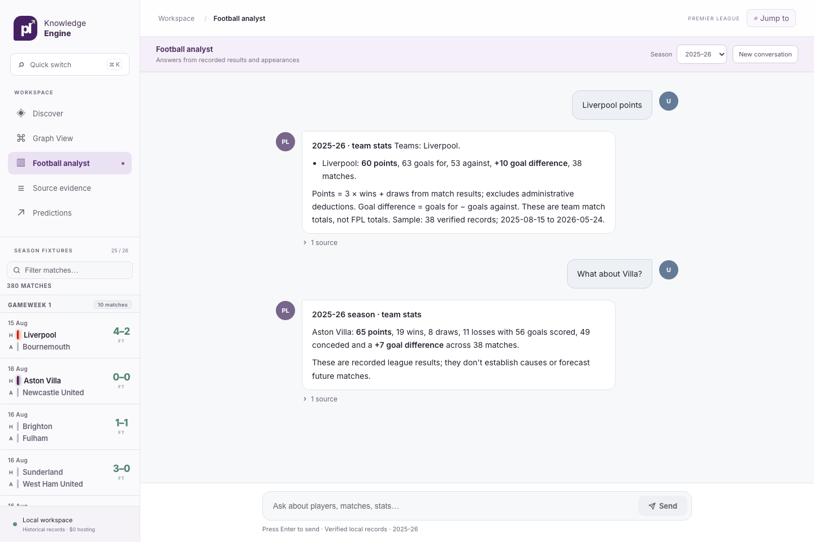

# Conversational football analyst

Open **Football analyst** in the local workspace. Choose one of the four verified result seasons, ask a question, and follow up in the same conversation. For example:

1. “How many points did Liverpool earn?”
2. “What about Villa?”
3. “How did they do at home?”

The chat keeps up to eight recent messages as context and remembers them for the current browser session. **New conversation** clears that context; switching seasons clears it too. A fixture with multiple home/away matches returns dated choices rather than guessing. Answers include original source links and record identifiers. Failed requests leave the question in the input for retry.

The 2022–23 through 2025–26 seasons support verified match results and club form. Named player appearances, player rankings and match goal/assist contributors use the reviewed 2025–26 Aston Villa and Liverpool snapshot. Match contributor replies label that partial coverage. The local model interprets some flexible wording; code calculates every number and selects every citation from hash-checked original records. It does not write factual answers. Causal, tactical, injury, betting and future-outcome questions receive an explicit limitation.

The Docker demo connects to the existing **qwen2.5:7b** model on the host through `host.docker.internal:11434`. No model download or provider account is part of deployment. To prepare another local machine, install Ollama, run `ollama pull qwen2.5:7b` (a free local download of roughly 5 GB), and start its local service. If Ollama is unavailable, direct supported questions and rule-based follow-ups still work; other wording gets a clarification. The route uses a 35-second model timeout, and some first questions can take longer while the model loads. To use a different installed local model, set `CONVERSATION_MODEL` and `CONVERSATION_MODEL_URL` for the app container. Leaving `CONVERSATION_MODEL` empty disables model routing.

The `POST /api/chat` contract accepts `message` (1–4,096 characters), `history` (up to eight bounded user/assistant messages) and `season` (one of four accepted seasons). It returns `status`, `season`, `reply`, `sources` and optional dated `suggestions`. Only user turns are considered for referents. Unknown seasons, system-role messages and oversized history are rejected. The legacy typed `/api/analysis`, Source evidence and Predictions endpoints remain available.

Run `npm run build` in `frontend/` and `npx playwright test tests/conversation.spec.ts` for UI validation. Python conversation checks are in `tests/test_analysis/test_conversation.py` and run in the standard test suite. The browser checks cover context sent to the API, citation links, ambiguous choices, season reset, session reload and failure retry on desktop and mobile.
