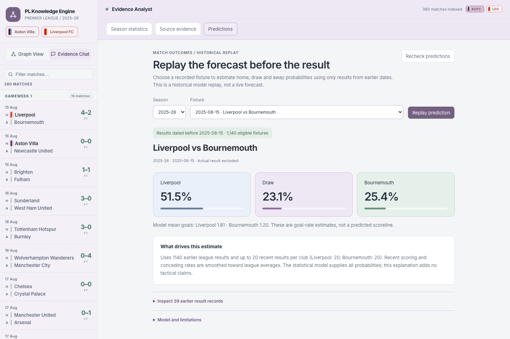
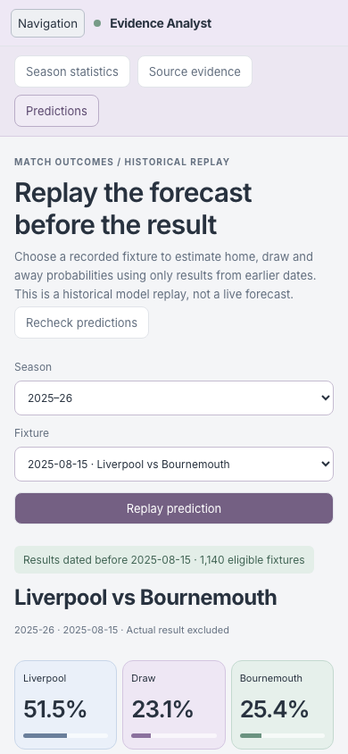

# Historical prediction workflow

Open **Evidence Chat → Predictions** in the local app. Choose 2024–25 or 2025–26,
select a recorded fixture and replay its home/draw/away forecast. The 760-fixture
catalogue covers all 20 clubs in each season. This is a retrospective statistical
workflow, not a live upcoming-fixture service or Gemini-generated forecast.





## Start and reproduce

```bash
python3 scripts/demo.py evidence
```

The expanded launcher collects the pinned results and prepares the optional local
stores. Existing installations reuse their source/model caches. Open
http://127.0.0.1:8010. Predictions need the four original result CSVs, independently
of Neo4j, Chroma, ONNX or provider readiness. The default MVP-only launcher does not
collect historical seasons; an unavailable Predictions tab offers a recheck while
statistics remain usable.

Reproduce the two-season evaluation inside the rebuilt container:

```bash
docker exec pl-knowledge-engine-demo-app-1 .venv/bin/python scripts/evaluate_workflow.py
docker exec pl-knowledge-engine-demo-app-1 .venv/bin/python scripts/accept_prediction.py --url http://127.0.0.1:8000
```

For native setup, collect the historical results and MVP first, then run
`uv run --locked python scripts/evaluate_workflow.py`. `--output PATH` selects the
source/report directory. No provider keys, generation, embedding or paid calls are
used. The generated `data/reports/prediction/workflow-v1.json` stays outside Git.

## API

`GET /api/prediction/status` verifies all four original CSVs against reviewed hashes
and complete-season coverage, recomputes validation-only model selection, and
returns fixture identities plus two-season evaluation/calibration/score intervals.
The catalogue omits observed fixture scores. The frozen 20-match window must agree
with validation selection; changed selection fails closed.

`POST /api/analyst/prediction` accepts exactly one canonical fixture identity:

```json
{"match_id": "pl:2025-26:liverpool:bournemouth"}
```

Use an ID from the catalogue. Arbitrary dates, freeform teams, alternate windows,
unsupported seasons and unknown fields are not accepted. The response contains:

- Home/draw/away probabilities and model mean goal rates, never an asserted scoreline.
- Fixture identity, exclusive date cutoff, eligible history count and latest date.
- Frozen model/window/selection season and reproducible history/dataset hashes.
- A deterministic explanation of the statistical inputs.
- At most 40 earlier team result records, each with original CSV row and revision.
- Explicit scope and source-publication limitations.

The target result is omitted from the fixture response and model inputs. The
independent sidebar still displays recorded 2025–26 results. Earlier team evidence
is the union of each club's last 20 fixtures; shared fixtures appear once. Expanding
league averages use all earlier results, not only those cards. The history hash
and pinned source contracts allow reconstruction of those inputs.

A malformed request returns 422, an unsupported fixture 404, unavailable or changed
sources 503, and concurrent verification 429 with `Retry-After: 2`. Internal paths
and exceptions are redacted. One verification job per API worker is permitted.
Requests use fresh source checks; results are not served from an unchecked report.
The source snapshot is rechecked after forecasting. Catalogue verification took
approximately 4.6 seconds on the local host; this is not a throughput benchmark.

## Date cutoffs and explanations

The model and explanatory cards include only matches whose result date is strictly
before the selected fixture date. Target, same-day and later results are excluded.
Model selection uses only 2023–24 validation losses; held-out outcomes cannot tune
settings. Prior held-out results do update subsequent features in the walk-forward
protocol. See the [baseline specification](prediction-evaluation.md).

Source CSVs do not supply reliable publication timestamps and may contain later
corrections. Therefore **result-date filtering is not a guarantee of information
availability at kickoff**. No post-match transcripts, final-season player totals,
injuries, lineups, odds, tactical observations or unrestricted graph/vector retrieval
enter this explanation. This deliberate source restriction prevents mixing the
existing post-match evidence retriever into a pre-match explanation. The ordinary
chat and Source evidence modes continue abstaining from prediction requests.

## Two-season evaluation and uncertainty

Settings remain frozen: window selected from 5/10/20 on 2023–24 validation; ten
league-average pseudo-matches for smoothing; independent Poisson goals.

| Replay season | Fixtures | Rolling log loss ↓ | League log loss ↓ | Rolling Brier ↓ | League Brier ↓ | Accuracy |
| --- | --- | --- | --- | --- | --- | --- |
| 2024–25 | 380 | 0.992406 | 1.081791 | 0.592023 | 0.656312 | 51.32% |
| 2025–26 | 380 | 1.035002 | 1.082370 | 0.621385 | 0.655126 | 48.16% |

2025–26 is an additional retrospective test, not a prospectively preregistered
trial. Lower log loss/Brier are better; neither season is a live-forecast claim.

Reports include five fixed probability bins per outcome, with counts, mean
probabilities and observed frequencies. These are descriptive calibration checks;
no post-hoc probability calibration is fitted on either held-out season.

Approximate 95% percentile intervals use 500 paired **date-block** bootstrap
resamples (seed 1729). All fixtures from a sampled date remain together. Paired
loss differences compare the same sampled fixtures against the league baseline.

| Season | Accuracy interval | Log-loss interval | Rolling minus league log-loss interval |
| --- | --- | --- | --- |
| 2024–25 | 46.7–56.6% | 0.949–1.032 | −0.121 to −0.056 |
| 2025–26 | 42.9–52.7% | 1.001–1.072 | −0.072 to −0.022 |

These intervals describe score variation within the observed season. Date blocks
do not capture all serial dependence or season drift. They are not intervals on
an individual forecast, proof of calibrated probabilities, betting profitability,
or assurance of future model skill. The UI reports these limits alongside results.

## Validation

Python regressions cover target/same-day/future exclusion, unchanged validation
selection after test-outcome mutation, two-season isolation, paired deterministic
bootstrap, descriptive calibration, bounded provenance, source-change rejection,
strict requests, busy/unavailable errors and redaction. Browser checks cover both
screen sizes, probability/cutoff/source display, selection resets and retry states.

Real unmocked forecasts for both seasons matched their offline evaluation. Real
desktop/mobile browser runs opened original sources, changed seasons and verified
no horizontal overflow. Capture these views with:

```bash
cd frontend
PL_DEMO_URL=http://127.0.0.1:8010 node scripts/capture-prediction.mjs
```
